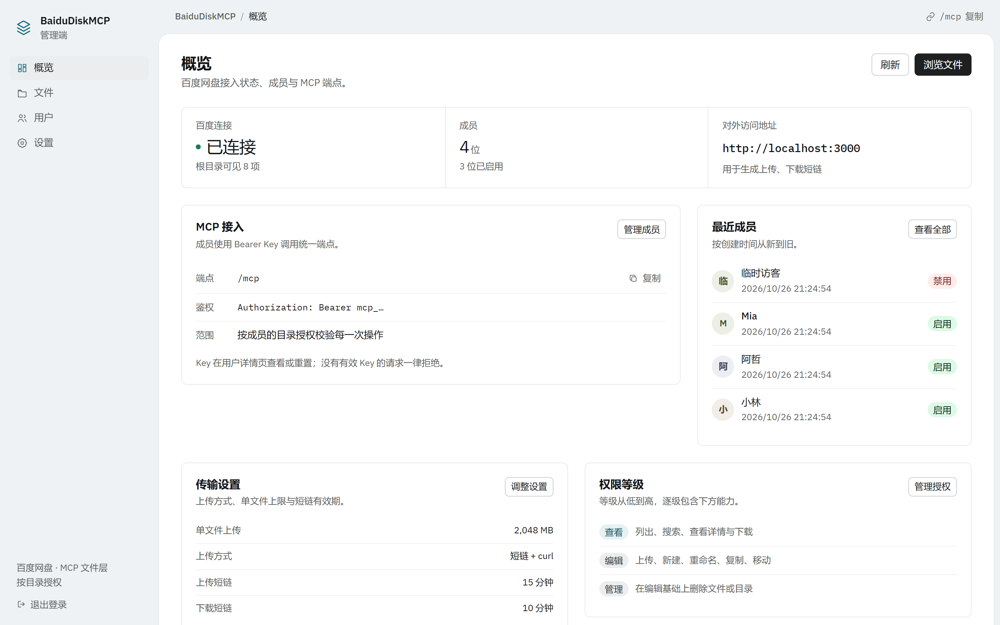
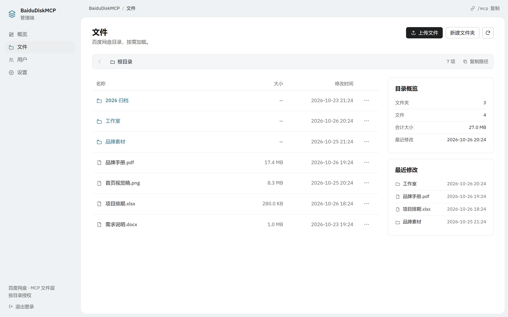
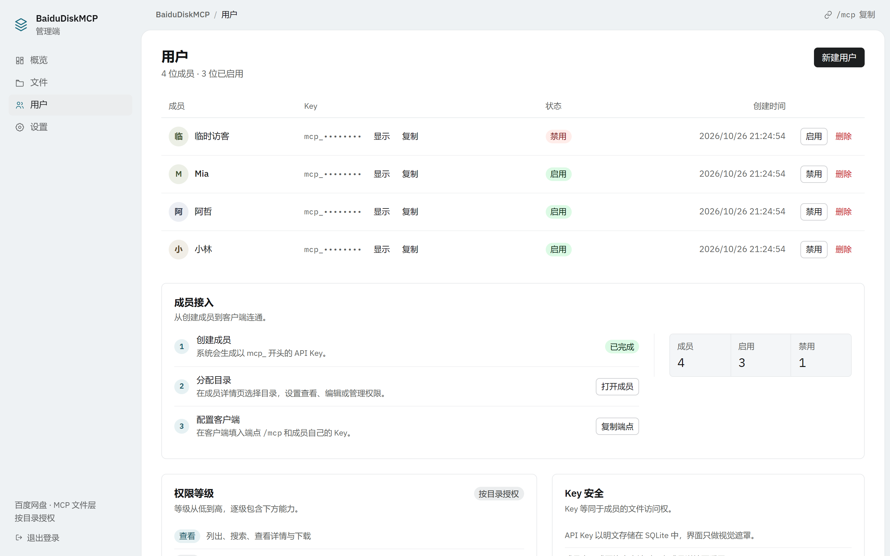
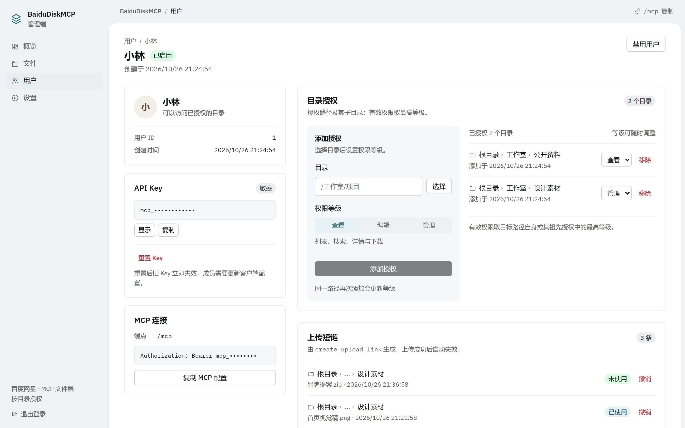
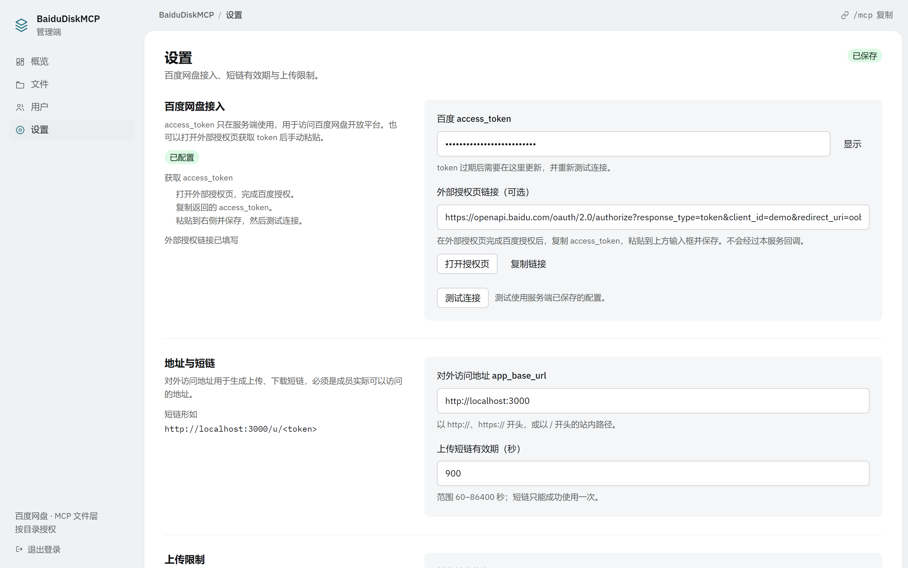

<div align="center">

# BaiduDiskMCP

**把百度网盘变成团队共享盘，通过 MCP 让 Claude、Cursor 等 AI 客户端安全访问文件。**

[](https://github.com/Coder-AIX/BaiduDiskMCP/releases/latest)
[](#许可协议)
[](#安装与启动)

[下载最新版](https://github.com/Coder-AIX/BaiduDiskMCP/releases/latest) · [部署文档](docs/DEPLOY.md) · [开发与打包](docs/DEVELOPMENT.md)

</div>



## 功能

- **百度网盘作为存储后端**：文件始终保存在百度网盘，服务不额外存储文件。
- **管理端统一配置**：保存百度 `access_token`，测试连接，管理短链与上传上限。
- **成员与目录授权**：为每位成员生成独立 API Key，并按目录授予 `view` / `edit` / `manage` 权限。
- **MCP 文件访问**：一个标准 MCP 端点，支持列出、搜索、详情、下载、上传、复制、移动、重命名、删除。
- **上传下载短链**：MCP 通过短链 + `curl` 上传下载，不向成员暴露百度 `access_token`。
- **网页端文件管理**：管理端可直接浏览、上传、下载、新建、重命名、移动、复制和删除文件。
- **多平台运行**：Windows / Linux / macOS 便携包，或 Docker 部署。

## 界面

<p align="center">
  
  
</p>

<p align="center">
  
  
</p>

## 安装与启动

### Windows

1. 从 [Releases](https://github.com/Coder-AIX/BaiduDiskMCP/releases/latest) 下载 `BaiduDiskMCP-*-win-x64.zip`。
2. 解压后双击 `BaiduDiskMCP.exe`。
3. 浏览器会自动打开 `http://localhost:3000/admin`。

不需要自动打开浏览器时，可执行：

```bat
BaiduDiskMCP.exe --no-browser
```

### Linux

```bash
tar -xzf BaiduDiskMCP-*-linux-x64.tar.gz
cd BaiduDiskMCP-*-linux-x64
./start.sh
```

支持 glibc 系统（Debian / Ubuntu / CentOS 等），不支持 Alpine。

### macOS

```bash
tar -xzf BaiduDiskMCP-*-macos-arm64.tar.gz
cd BaiduDiskMCP-*-macos-arm64
```

双击 `start.command`。如果被 Gatekeeper 拦截，右键选择「打开」，或执行：

```bash
xattr -dr com.apple.quarantine BaiduDiskMCP-*-macos-arm64
```

Intel Mac 请下载 `macos-x64` 版本。

### Docker

```bash
cp .env.example .env
docker compose up -d --build
```

访问 `http://localhost:3000/admin`。修改端口或对外地址时，同时更新 `.env` 中的 `PORT` 和 `APP_BASE_URL`。

### 从源码运行

需要 Node.js 22 或更高版本。

```bash
npm install
cp .env.example .env
npm run dev
```

生产运行：

```bash
npm run build
npm start
```

## 首次配置

1. 打开 `/admin`，首次访问会要求设置管理员密码（至少 10 个字符）。
2. 进入 `/admin/settings`，填写百度网盘 `access_token` 并保存。
3. 点击「测试连接」，确认可以正常访问百度网盘。
4. 进入 `/admin/users` 创建成员，系统会生成 `mcp_` 开头的 API Key。
5. 在成员详情页添加目录授权，选择目录和等级。
6. 把 MCP 端点与成员的 API Key 发给成员。

> 需要从根目录开始浏览时，请显式授予 `/` 的权限。

## 接入 MCP

MCP 端点：

```text
http://<host>:3000/mcp
```

鉴权头：

```text
Authorization: Bearer mcp_xxxxxxxx
```

同时支持 `X-API-Key: mcp_xxxxxxxx` 和查询参数 `?key=mcp_xxxxxxxx`。

仅支持 stdio 的客户端（如 Claude Desktop）可通过 `mcp-remote` 转发：

```json
{
    "mcpServers": {
        "BaiduDiskMCP": {
            "command": "npx",
            "args": [
                "mcp-remote",
                "http://localhost:3000/mcp",
                "--header",
                "Authorization: Bearer mcp_xxxxxxxx"
            ]
        }
    }
}
```

Cursor 或其他支持 Streamable HTTP 的客户端，直接填写 MCP 端点并添加鉴权头即可。

### 工具清单

| 工具 | 用途 | 所需权限 |
|---|---|---|
| `whoami` | 查看当前用户、目录授权与权限等级 | 有效 Key |
| `list_files` | 列出目录内容 | `view` |
| `search_files` | 按关键字搜索文件 | `view` |
| `stat_file` | 查询文件或目录详情 | `view` |
| `get_download_link` | 生成下载短链 | `view` |
| `create_upload_link` | 生成上传短链 | `edit` |
| `copy_file` | 复制文件或目录 | 源 `view` + 目标 `edit` |
| `create_folder` | 新建文件夹 | `edit` |
| `rename_file` | 重命名文件或目录 | `edit` |
| `move_file` | 移动文件或目录 | `edit` |
| `delete_files` | 批量删除 | `manage` |

## 上传与下载

MCP 上传统一使用短链 + `curl`：

```bash
curl -X POST "http://localhost:3000/u/<token>" -F "file=@/path/to/file.zip"
```

下载：

```bash
curl -L -C - "http://localhost:3000/d/<token>" -o file.zip
```

上传短链默认 15 分钟有效且只能成功使用一次；下载短链 10 分钟有效，支持断点续传。短链中不包含百度 `access_token`，权限撤销后会立即失效。

## 权限模型

等级从低到高为 `view < edit < manage`：

| 等级 | 能力 |
|---|---|
| `view` | 列出目录、搜索、查看详情、下载 |
| `edit` | 在 `view` 基础上上传、新建文件夹、重命名、复制、移动 |
| `manage` | 在 `edit` 基础上删除文件或目录 |

授权路径会覆盖其所有子目录；没有匹配授权即无权限。

## 常见问题

**401：无法连接 MCP**

检查 Key 是否完整、格式是否为 `Authorization: Bearer mcp_...`，并确认成员未被禁用。重置 Key 后旧 Key 立即失效。

**403：操作被拒绝**

确认成员对目标路径有对应等级的授权。复制需要源 `view` + 目标 `edit`，移动需要两端 `edit`，删除需要 `manage`。

**502：百度接口失败**

百度 `access_token` 通常约 30 天有效，过期后需要在管理端更新并重新测试连接。

**413：请求体过大**

依次检查 `.env` 中的 `BODY_SIZE_LIMIT`、反向代理的 `client_max_body_size`，以及管理端设置中的上传上限。

**MCP 客户端返回 405**

服务为无状态 Streamable HTTP，仅接受 `POST`。请使用支持该模式的客户端，或先用 `mcp-remote` 验证连通性。

## 数据与备份

- `data/app.db`：设置、成员、API Key、授权、短链和管理员密码哈希。
- `data/tmp`：上传临时文件，可随时清空。

备份时先停止服务，再复制整个 `data/` 目录。运行中备份还需一并复制 `app.db-wal`、`app.db-shm`。

## 许可协议

本项目采用**个人免费使用、禁止商用**的授权方式：

- **允许**：个人学习、研究与自用。
- **禁止**：任何形式的商业用途。
- **商业授权**：如需将本项目用于商业场景，须事先获得作者书面授权，可通过 [Issues](https://github.com/Coder-AIX/BaiduDiskMCP/issues) 联系作者。

本仓库不附带独立的 `LICENSE` 文件；以上说明即为本项目的许可声明。

## 更多文档

- [部署与反向代理](docs/DEPLOY.md)
- [开发、打包与发布](docs/DEVELOPMENT.md)
